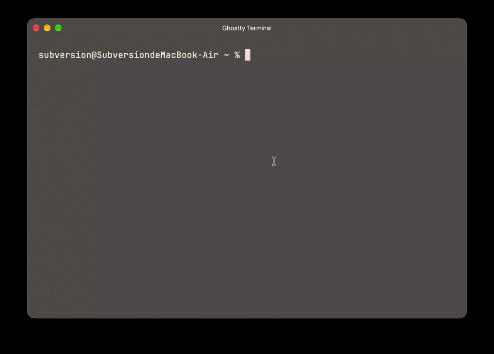

# whatcmd

Find terminal commands by describing them in plain English.

Type part of a command, press Ctrl-G, describe what you want, and pick a candidate. whatcmd inserts it at the cursor and never runs it for you.

See [docs/DESIGN.md](docs/DESIGN.md) for the design and [docs/DEVELOPMENT.md](docs/DEVELOPMENT.md) for building from source.
