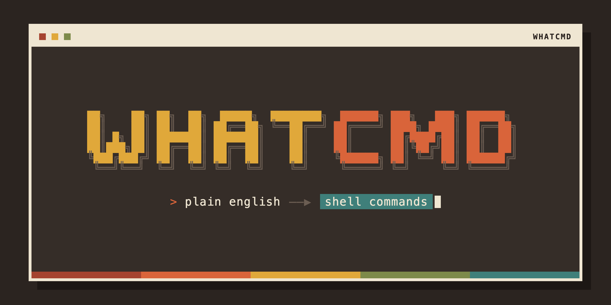
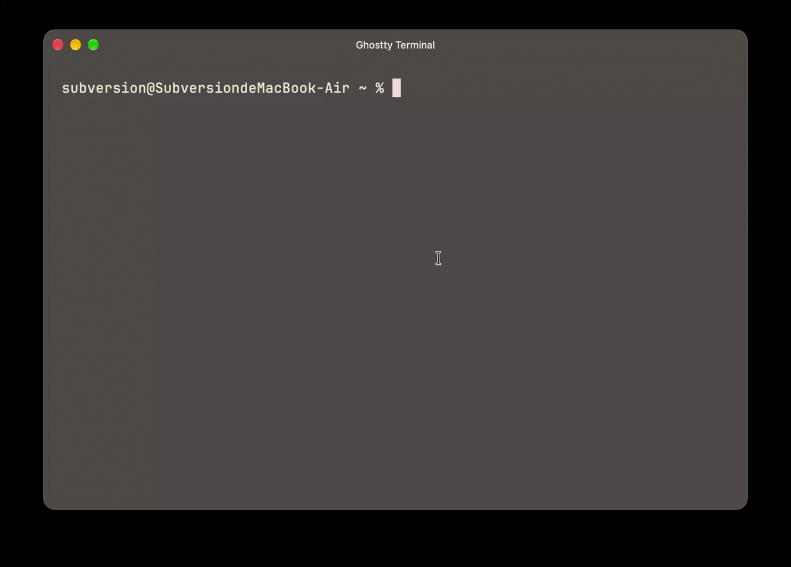

# whatcmd

用英文自然语言描述你想做的事，找到对应的终端命令。

[English](README.md)





输入命令的一部分，按 `Ctrl-G`，描述你想做什么，然后选一个候选。whatcmd 会把它插入光标处，从不替你执行任何东西。

- **锚点搜索。** 命令行上已经输入的内容会限定搜索范围。输入 `git ` 之后，只搜索 git 的子命令和选项。
- **命令树索引。** 命令、子命令（`git remote add`）和长参数（`git clone --branch`）各自作为独立节点建立索引。
- **语义匹配。** 查询文本会被向量化，再和生成的描述做比较，所以 `undo my last commit` 即使没有关键词重叠，也能找到 `git reset`。
- **从使用中学习。** 被选中的候选会得到一个小的、随时间衰减的加分。
- **设计上保证安全。** 只修改命令行缓冲区。涉及 `rm`、`dd`、`mkfs` 等的示例会被标记，选中时需要确认。

## 安装

运行环境：macOS 或 Linux、zsh、[fzf](https://github.com/junegunn/fzf)，以及一个 OpenAI 兼容 embedding 接口的 API key。只有自己运行 `reindex` 时才需要 Claude Code。

从 [Releases](https://github.com/SoubanLoveRock/what-cmd/releases) 下载对应平台的压缩包，然后执行：

```bash
tar -xzf whatcmd-0.1.0-<target>.tar.gz
cd whatcmd-0.1.0-<target>
install -m 755 whatcmd ~/.local/bin/          # 任意一个在 PATH 中的目录
mkdir -p ~/.config/whatcmd ~/.local/share/whatcmd/shell
cp config.example.toml ~/.config/whatcmd/config.toml
cp shell/whatcmd.zsh ~/.local/share/whatcmd/shell/
```

macOS 上下载的二进制可能被标记为隔离（quarantine），可以用 `xattr -d com.apple.quarantine ~/.local/bin/whatcmd` 清除。

也可以从源码构建（需要 Rust 1.85+）：

```bash
cargo install --path . --locked
```

## 配置

1. 把 embedding 的 key 放进环境变量。程序只从 `api_key_env` 指定的变量读取，从不写入配置文件：

   ```bash
   export WHATCMD_EMBEDDING_API_KEY=...   # 例如放在 ~/.zshenv，或从钥匙串读取
   ```

2. 在 `~/.zshrc` 中加载 widget：

   ```bash
   source ~/.local/share/whatcmd/shell/whatcmd.zsh
   ```

3. 打开一个新的 shell，按 `Ctrl-G`。

发布包内附带一份约 120 个 POSIX 命令的预置索引，使用 `BAAI/bge-m3`（1024 维）生成。如果保留示例配置，安装后就能直接使用。

## 用法

| 输入条中 | 效果 |
|---|---|
| 普通文本 | 搜索，然后用方向键选择、回车确认 |
| `/reindex` | 打开功能菜单并重建索引 |
| `Esc` | 关闭输入条，命令行保持不变 |

命令行方式：

```bash
whatcmd query --prefix "git " -- push my commits to remote
whatcmd record "git push"
whatcmd reindex --names git,docker   # 只索引指定命令
whatcmd reindex                      # 扫描整个 PATH
```

退出码：`0` 有结果；`1` 无结果（或 reindex 有失败）；`2` 配置、索引或锚点错误；`3` embedding 服务不可用。

## 工作原理

### 查询

每次 `Ctrl-G` 执行 `whatcmd query --prefix "$LBUFFER" -- <text>`，步骤如下：

1. **锚点（纯本地）。** 光标左侧的文本按空白切分。末尾没有空格的未完成词会被丢弃。第一个 token 必须是已知的根命令，否则退出码为 `2`；如果编辑距离不超过 2，会给出拼写建议。之后的 token 若是子命令，就把锚点下移一层。以 `-` 开头的 token 被跳过，单独的 `--` 会停止锚点解析，遇到其他 token 也会停止。因此 `git -C repo clone ` 的锚点停在 `git`。
2. **向量化。** 规范化后的查询文本发送到 `embedding.endpoint`。查询为空时退出码为 `2`；embedding 失败时为 `3`。
3. **在锚点子树内打分。** 节点的自身分是查询向量和节点向量的余弦相似度。向量在写入前做了 L2 归一化，因此余弦值就是点积。节点还会继承后代分数乘以 `0.8^depth` 的结果，所以即使 `git clone` 自身不匹配，只要 `--branch` 匹配，它也能排得靠前。只有分数至少为 `0.30` 的节点才算候选。
4. **回退。** 如果锚点子树中没有符合条件的候选，就依次向父节点、直到根节点搜索。从锚点以上层级找到的候选会带上 `via` 标记，widget 可以据此提示它们不在当前范围内。
5. **排序。** 查询文本与某个节点的 key 完全相等时，该节点排第一。其余按分数加使用加分排序，使用加分为 `min(0.10, 0.05 × ln(1 + count))`，每 30 天减半一次。命令行上已经出现过的长参数不会再次推荐。

插入候选时，只写入它路径中锚点之后的部分，写在光标处；如果有未完成的词，则替换它。`RBUFFER` 保持不变，也不会发送回车。目前打分系数固定在代码中，只有在固定样本集上调好之后，才会考虑移入配置。

### 索引

文件存放在 `index_dir`（默认 `~/.local/share/whatcmd`）：

- `index.json` 保存 schema 版本（当前为 2）、生成信息（agent 版本和 prompt 版本）、embedding 模型和维度、`vectors.bin` 的 SHA-256，以及每个节点的一条记录。命令节点的 key 是完整路径，如 `git remote add`；参数节点是长参数，如 `git clone --branch`。每条记录包含父节点、描述、示例、source hash、向量行号和 `pinned` 标记。
- `vectors.bin` 每个节点一行，小端序 `f32`，行长等于配置的维度。

两个文件都先写入 `.tmp` 文件，再重命名到正式位置。加载时会拒绝 schema 不匹配、`vectors.bin` 大小与节点数不一致，以及校验和不匹配的索引。校验和用于发现两次 rename 之间崩溃的情况：那时可能出现新的 `index.json` 配旧的 `vectors.bin`。

### 预置索引

程序内置约 120 个 POSIX 命令的描述和向量（`BAAI/bge-m3`，1024 维）。如果 `index_dir` 中没有 `index.json`，就把预置索引写进去，不调用 LLM。如果配置的模型或维度与预置不一致，则跳过预置，由第一次 reindex 建立索引。预置节点标记为 `pinned`：reindex 既不会重新生成它们，也不会删除它们。

### Reindex

`whatcmd reindex` 按以下顺序执行：

1. 获取 `index.lock`，避免两次运行同时写入。
2. 扫描 `$PATH` 中所有可执行文件，并去除重名项。
3. 对每个命令读取 man 页面，没有时退回 `--help`。输出会去掉 ANSI 转义和退格符，并截断到 `max_doc_bytes`（默认 64 KiB）。
4. 把每个命令的文档交给 [Claude Code](https://claude.com/claude-code)，调用形式为 `claude -p --tools "" --model haiku --output-format json --json-schema …`。最多 `agent.concurrency` 个批次同时运行，每次调用超时 600 秒。提示词带版本号，并作为 source hash 的一部分，因此提示词变化会重新生成受影响的节点；在同一提示词版本下，文档未变的节点直接复用。
5. 模型给出的子命令会先用 `<cmd> <sub> --help` 检查，然后才进入队列。检查时接受 stdout 中的输出，嵌套路径会尝试 `-h`，仍失败则退回父命令的帮助文本。遍历深度不超过 `reindex.max_depth`（默认 3）。
6. 每个结果经校验后写入 `~/.cache/whatcmd/staging` 下的暂存文件。之后再分批做 embedding。如果 embedding 失败，暂存结果保留，下次运行直接做 embedding，不会再次调用 LLM。
7. 新索引原子地替换旧索引。失败的节点保留原来的条目。全部成功时退出码为 `0`，有任何失败则为 `1`。

进度和警告输出到 stderr，同样的内容也会追加到缓存目录中的 `reindex.log`。

### 安全

- 模型不能使用任何工具。是 `--tools ""` 禁用了工具；本机实验中，只传 `--allowedTools` 时 Bash 仍会执行。样本量很小，应把它当作证据，而不是定论。
- 模型输出先按 JSON 解析并校验，然后才会入库。命令名必须符合 `^[A-Za-z0-9][A-Za-z0-9._+-]{0,63}$`；参数必须以 `--` 开头。描述不超过 400 字符，示例最多 3 条，每条不超过 200 字符。
- 插入路径只修改命令行。含 `rm`、`dd`、`mkfs`、`> /dev/`、`chmod -R` 或 `chown -R` 的示例会被标记，选中时需要输入 `y` 才会插入。
- API key 只从 `api_key_env` 指定的环境变量读取。配置文件中若出现 `api_key`，会被拒绝。
- 使用记录只保存被选中的 key 和时间戳。

### 已知限制

- 对简短或模糊的查询，排序效果参差不齐。主要影响因素是提示词和描述质量，调优仍在进行中。
- 每次查询都需要 embedding 接口，暂时没有离线兜底。
- reindex 需要已登录的 `claude` CLI；查询只需要 embedding key。
- 尚未实现：`whatcmd doctor`、自动后台重建（`reindex --auto`），以及 `-v` / `WHATCMD_LOG` 日志开关。
- 支持的 shell 和平台：仅 zsh，仅 macOS 和 Linux。

## 隐私

- 查询文本和生成的描述会发送到你配置的 embedding 接口。
- reindex 时，命令文档会发送给 Claude。
- 使用记录（`usage_file`）只保存被选中的 key 和时间戳，且只存在本地。

## 开发

```bash
cargo fmt --check
cargo clippy --all-targets -- -D warnings
cargo test
scripts/package.sh            # 生成 dist/whatcmd-<version>-<host>.tar.gz
```

推送 `v*` tag 会触发 `.github/workflows/release.yml`，构建 macOS 和 Linux 的压缩包（arm64 与 x86_64），并附加到 GitHub Release。

设计说明见 [docs/DESIGN.md](docs/DESIGN.md)，接口见 [docs/INTERFACES.md](docs/INTERFACES.md)，决策记录见 [DEVLOG.md](DEVLOG.md)。这些文档为中文。
